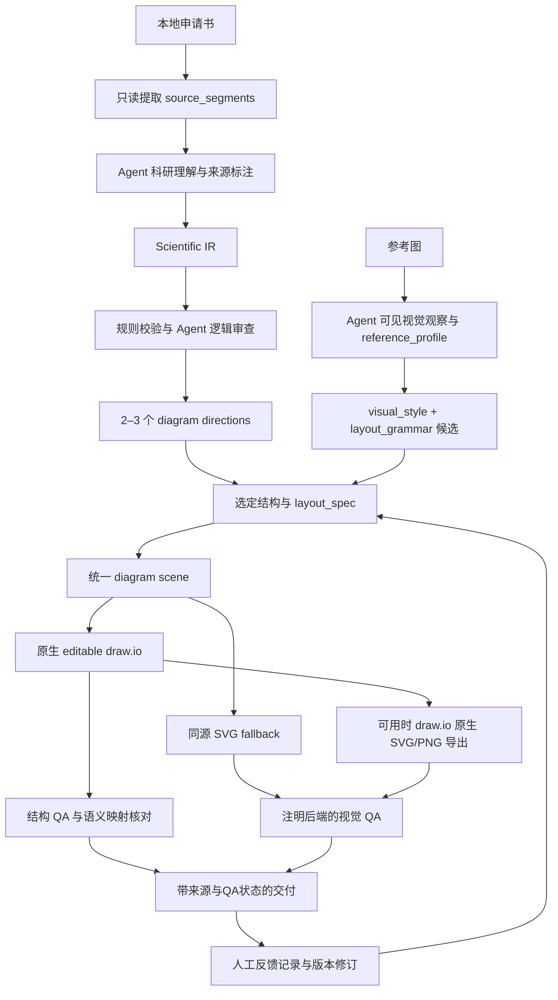

# 个人科研框架图 Skill 架构计划

日期：2026-10-04。状态：第一轮设计草案，尚未实现。当前只提交本文件、[upstream-analysis.md](upstream-analysis.md) 和最小初始化文件；本文中的目录、Schema和脚本均为后续计划，不表示已经存在或可运行。

## 1. 产品边界与核心决策

项目定位为中文科研项目申报书、基金申请书和课题申请书的个人科研框架图 Skill。draw.io 是图件后端，科研理解、来源、关系和图型选择构成独立核心。

排序依据固定为：科研逻辑准确 → 结构清晰 → 阅读顺序明确 → 可编辑 → 视觉美观。布局不能为了对称添节点、因果或反馈，也不能为压缩合并不同科研概念。

M1先接受 Markdown/TXT 和能简单抽取正文/表格的 DOCX。PDF高级解析、自动OCR和复杂视觉重建放到后续。科研概念判断和看图由Agent完成；确定性脚本负责源段落抽取、校验、布局几何、写图和导出，不承诺一个Python脚本独自读懂任何申请书。

已有工作区的参考图分析和申报书只作为设计经验。本轮不迁移真实文本、图片、反馈或过往生成图到这个公开仓库，也不把某个课题的概念固化到Skill。

## 2. 系统层次和数据边界



上图的回到G表示用户对图件的修改，不是在任何科研项目中凭空建立实验反馈关系。项目内的科学反馈只能由Scientific IR中的 `feeds_back_to` 表达。

| 层 | 输入/输出 | 能做什么 | 不能代替什么 |
|---|---|---|---|
| Source | 文件 → source_segments.json | 读取文本、表格定位、校验和与版本 | 不靠标题/段落相邻推理科学箭头 |
| Scientific Understanding | 源段落 → IR草稿 | Agent辨认概念、研究角色、假设状态、关系及不确定性 | 不是确定性OCR/词频分类器，也不是未经来源核实的事实判断 |
| Logic Review | IR → logic_review.md | 格式/来源规则检查＋Agent对照原文 | Schema通过不等于科研逻辑已被证实 |
| Structure | IR → diagram_directions.md | 按研究逻辑选2–3种结构并说明压缩/风险 | 不通过换颜色制造方案差异 |
| Layout | IR投影＋语法/风格 → layout_spec/scene | 分层、空间、文本框、端口、路径、纸面尺寸 | 不修改IR类型、陈述状态或证据 |
| Render | 同一scene → drawio、SVG或原生CLI产物 | 原生单元和完整文本；记录真实导出后端 | 不把PIL/SVG fallback冒充draw.io原生渲染 |
| Learning | 参考profiles＋明确用户反馈 →候选规则 | 结构化沉淀多图重复语法、版本偏好 | 不是参数微调，不从参考图猜科研结论 |

## 3. Scientific Ontology 草案

以下节点类型进入拟建 `schemas/scientific-ir.schema.json`。`progress` 为用户特别要求区分的类型，虽未出现在原最低枚举清单中，也作为一级类型加入。

| 角色族 | 类型 |
|---|---|
| 立题与问题 | background, research_gap, research_problem, scientific_question |
| 论证与目标 | hypothesis, overall_objective, sub_objective |
| 内容/组织/实施 | research_content, work_package, research_task, progress |
| 对象和输入 | research_object, material, data |
| 分析与条件 | method, comparison, condition, evidence |
| 过程与解释 | mechanism, process, validation, feedback |
| 应用与产出 | intervention, cultivation, output, innovation, limitation |

分类由科研功能决定，标签关键词只是线索。同一原文段落可能需要多个不同类型节点；同一个节点只承担一个主要科研角色。必要的兼属通过关系表达，不混成“方法兼任务兼结果”节点。

必须分开：

- `research_content`：要研究哪个问题/对象/认识内容。
- `research_task`：执行什么实验、创作、调查、采样或操作以产生资料。
- `method`：如何获得、分析、解释资料。
- `progress`：什么时候安排哪些工作。项目月份不会进入机制链。
- `mechanism`：拟解释或已有依据支持的作用/过程；状态随来源记录。
- `output`：预期或已报告产物，不能用已得结果语态显示预期成果。

“四项研究内容”“四次任务”“五种方法”不能按数量或条目次序连成一对一平行列表。对象、任务、方法、证据和时间可以服务多个内容模块，需通过来源关系明确归属。

## 4. Scientific IR 草案（只写在文档，尚不创建Schema文件）

### 4.1 顶层和字段

拟建Schema采用 JSON Schema Draft 2020-12，版本标识 `scientific-framework/ir/v1`。语义JSON与layout_spec分开。

| 对象 | 必需字段 | 补充字段/约束 |
|---|---|---|
| Project | title, source, diagram_purpose | id、title_status、working_title、source_snapshot_id、language；title可为null，但状态必须missing；暂定主题独立保存 |
| Node | id, label, short_label, type, level, group, source_text, source_location, confidence, needs_review | statement_status、extraction_status、diagram_priority；label保持术语完整，short_label仅用于显示；无坐标或配色 |
| Relation | id, source, target, relation, evidence, source_location, confidence, needs_review | statement_status、interpretation_note、core；核心关系至少一个可回到源片段的证据 |
| Source registry | source_id、format、文件别名、sha256；segments含segment_id/location/text | 本机绝对路径只存本地快照；公共示例使用相对路径/别名；不把整篇申请书嵌入SVG/PNG |
| Review item | id、subject_ids、issue、severity、needs_review | missing_source/unclear_direction/unsupported_relation等原因，所需澄清，不用空白补全未知 |

`source_location` 至少含source_id、segment_id和可靠定位字段。Markdown/TXT可用行范围；DOCX可用heading_path、body_paragraph_index、table_index/row_index/cell_index；PDF将来使用可验证页码/区域。不能从Word XML段落顺序猜页码。

`source_text` 是逐字源引文，允许多个片段；Relation的 `evidence` 为源ID、片段ID、quote与解释的列表。节点简写、关系解释与quote分开，脚本核对quote是否确实存在于固定版本source_segments。

`confidence` 在0–1范围，表示对本次角色/关系抽取解释的把握，不是研究结果正确率、因果成立概率或“已证实程度”。高confidence不能消除计划/假设状态。`needs_review=true`用于缺失、歧义或无法由原文确认的关键关系；原文明示的计划关系可以无需补问，但仍显示为计划。

`statement_status`拟支持：definition、background_claim、planned、hypothesized、expected、reported。`extraction_status`拟支持：explicit、normalized、inferred、missing。没有来源的inferred关键边必须待审；reported只是“原文报告”，不代表本系统独立验证。

### 4.2 关系词表及显示语义

最低支持用户要求的：contains、leads_to、enables、depends_on、influences、compares_with、contrasts_with、validates、evidence_for、transforms_to、feeds_back_to、temporal_before、parallel_with、supports、applies_to。

另建议加入有实际用途的 `addresses`、`uses`、`produces`，分别表示内容回答问题、任务/内容采用方法或材料、过程预计形成产物。`causes`作为严格区别于influences的可选类型，默认不生成；只有原文明确提出该因果命题才可录入，且保留hypothesized/planned/reported状态，不能将其当作本系统证实的因果。

| 关系 | Scientific IR 含义 | 默认显示原则 |
|---|---|---|
| contains | 内容/集合归属 | 父子容器或无箭头分支，不默认因果箭头 |
| temporal_before | 时间或原文明示的研究顺序 | 带“阶段/顺序”提示的单向边，不冒充影响 |
| parallel_with | 同层并列 | 对齐/共同上级；无需强加箭头 |
| compares_with / contrasts_with | 对照与比较 | 同级比较区或无方向关系线，不改为leads_to |
| influences | 来源明确的影响命题 | 影响标签＋陈述状态；不升级为causes |
| enables / depends_on | 前置条件/支撑或依赖 | 有方向且有简短类型提示；区别于时间 |
| supports / evidence_for | 支持/证据关系 | 从属证据层；不把数据尚未收集写成已有证据 |
| validates | 检验哪个假设/机制/产物 | 明确对象和计划状态，不能一个泛“验证”框代替关系 |
| feeds_back_to | 何种信号更新哪个对象 | 显式返回及更新对象；“反馈”一词不足以建立全图回路 |
| transforms_to / produces | 对象转换/预计形成产物 | 过程到产物；预期成果保留预期语态 |
| applies_to / uses / addresses | 方法适用、使用、回应问题 | 侧层或从属短边；不与研究主线混用 |
| leads_to | 原文明确的推进/转换/结果连接 | 必须写明具体解释和状态；模糊时待审，不作为通用箭头占位词 |

### 4.3 最小数据示例（合成，不来自真实申请书）

合成源文件按以下两行保存，分别对应片段p1和p2：

```text
研究内容一为课堂判断过程还原，拟采用过程追踪法。
四次课堂活动用于收集连续过程资料。
```

研究内容、方法、任务三类都出现，但只有研究内容采用方法的关系在此例明确给出。

```json
{
  "schema_version": "scientific-framework/ir/v1",
  "project": {
    "id": "synthetic-demo",
    "title": null,
    "title_status": "missing",
    "working_title": "教学研究示例（暂定）",
    "source": [{"source_id": "s1", "format": "txt", "file_alias": "synthetic.txt"}],
    "diagram_purpose": "overall_research_approach"
  },
  "nodes": [
    {
      "id": "c1", "label": "课堂判断过程还原", "short_label": "过程还原",
      "type": "research_content", "level": 1, "group": "main_backbone",
      "source_text": ["研究内容一为课堂判断过程还原，拟采用过程追踪法。"],
      "source_location": [{"source_id": "s1", "segment_id": "p1", "line_start": 1, "line_end": 1}],
      "confidence": 0.98, "needs_review": false,
      "statement_status": "planned", "extraction_status": "explicit"
    },
    {
      "id": "m1", "label": "过程追踪法", "short_label": "过程追踪",
      "type": "method", "level": 2, "group": "methods",
      "source_text": ["拟采用过程追踪法"],
      "source_location": [{"source_id": "s1", "segment_id": "p1", "line_start": 1, "line_end": 1}],
      "confidence": 0.98, "needs_review": false,
      "statement_status": "planned", "extraction_status": "explicit"
    },
    {
      "id": "t1", "label": "四次课堂活动用于收集连续过程资料", "short_label": "四次活动资料采集",
      "type": "research_task", "level": 2, "group": "task_sequence",
      "source_text": ["四次课堂活动用于收集连续过程资料。"],
      "source_location": [{"source_id": "s1", "segment_id": "p2", "line_start": 2, "line_end": 2}],
      "confidence": 0.98, "needs_review": false,
      "statement_status": "planned", "extraction_status": "explicit"
    }
  ],
  "relations": [
    {
      "id": "r1", "source": "c1", "target": "m1", "relation": "uses",
      "evidence": [{"source_id": "s1", "segment_id": "p1", "quote": "研究内容一为课堂判断过程还原，拟采用过程追踪法。"}],
      "source_location": [{"source_id": "s1", "segment_id": "p1", "line_start": 1, "line_end": 1}],
      "confidence": 0.98, "needs_review": false,
      "statement_status": "planned", "interpretation_note": "研究内容采用方法，非导致研究结论。", "core": true
    }
  ],
  "review_items": [
    {"id": "u1", "subject_ids": ["c1", "t1"], "needs_review": true, "issue": "四次活动具体怎样服务各研究内容，此源句未说明；不新增一对一边。"}
  ]
}
```

上述示例用于说明字段，尚不是完整Schema验证样本；实现时补source snapshot、文件sha256、完整registry以及各字段的机器约束。未给的关系放review_items，不为了凑箭头创建“已支持”关系。

### 4.4 校验分工

确定性规则检查ID/端点/类型、来源片段、引文匹配、状态字段、必需证据、contains归属循环等；不能靠同名、同数量匹配任务和内容。Agent对照原文检查关系蕴含、遗漏、术语及主线；有source_text字段不代表自动证明原文支持该箭头。

Schema/来源错误和影响核心科学含义的歧义阻止“最终图”状态。可先交付可审阅草稿，且未定关系不作为确定机制。闭环关系允许真实的feeds_back_to；不能把所有环都判为错误，也不能把包含关系环当作科学反馈。

## 5. Proposal Analysis 与总体研究思路图

`proposal-analysis.md`负责中文六栏正文/普通基金申请书的角色抽取：背景、现状、缺口、意义、概念、问题、目标、内容、难题、对象、实验/创作任务、方法、资料、过程证据、比较条件、机制、验证、形成条件、培育/干预、反馈、成果、创新、进度。

“拟研究/拟形成/检验是否/预计产出”等语态保留；结果句、计划句、假设句分开。去重仅合并真正同义且同角色的节点，保留源段落清单；不为了图面简洁抹掉方法、任务和内容的差别。

总体研究思路图主要回答怎样推进研究。常见骨架为：研究入口/问题 → 主研究阶段 → 机制解释 → 干预/培育/解决路径 → 最终产物。没有机制、干预或因果的项目不得套入这些节点。

对象、方法、实施任务、证据与进度一般为secondary layer，按真实适用关系附属主骨架。任务可贯穿多个研究内容，方法可复用，时间轨独立。当图目的改为研究设计/进度安排时，任务与条件才可能成为主层。

## 6. 科研图型库与M1布局能力

每个type将按统一字段定义：purpose、suitable_content_structure、unsuitable_cases、reading_direction、main_backbone、recommended_major_modules、hierarchy_depth、typical_secondary_layers、preferred_edge_semantics、common_failure_modes。

| 图型 | 首要目的/适配逻辑 | 默认主路径/骨架 | 典型不适用情况 |
|---|---|---|---|
| 总体研究思路框架图 | 解释研究怎样推进 | TB/LR；入口、核心问题、研究阶段、产物 | 阶段顺序未确定时不能强连 |
| 研究框架图 | 呈现问题、目标、内容及支撑关系 | 分层；问题/目标—内容—证据 | 不能等同章节目录 |
| 技术路线图 | 输入、处理、转换及验证顺序 | LR/TB；输入—处理—检验—输出 | 并列内容无真实时序 |
| 研究设计图 | 对象、条件、任务、采集/分析关系 | 条件/任务/证据主层 | 用流程图暗示随机化或因果效果 |
| 机制图 | 明确或拟检验的作用关系 | 机制路径/网络，显式命题状态 | 只有研究步骤，没有机制依据 |
| 问题—内容—方法三栏 | 区段内三种角色真实对应 | 中央主内容＋两侧索引 | 方法跨模块共享而行对齐会误导 |
| 纵向阶段递进 | 明确研究/执行阶段 | TB重复阶段；细节附属 | 强行给并列任务加时序 |
| 平行任务汇聚 | 多路任务共同形成模型/认识/产物 | 并列分支→汇总 | 任务实际依赖上一任务 |
| 中心机制＋周围证据 | 核心命题由多路证据/实验检验 | 中心/周边，方向标明拟检验 | 无核心机制或外围路径太复杂 |
| 输入—过程—机制—输出 | 数据/对象转换与解释链有依据 | LR/TB；只取实际存在角色 | 为凑节点虚构机制或数据 |
| 多阶段闭环 | 实测/分析信号更新具体对象 | 顺向主路径＋明确返回 | 出现“反馈”词但没有返回目标/信号 |
| 问题—任务—证据双层 | 内容目标和执行/证据不等同 | 主问题/内容层＋下属任务证据层 | 两层仅因节点数相同就一一配对 |

**能力分期**：M1形成全部12类的选择指南/风险边界，实际自动布局首先实现纵向主轴、问题—内容—方法三栏、内容＋证据双层三种语法。主轴可支持明确的局部反馈，前提是IR有对应关系。并不宣称M1已能自动渲染全部12类的任意复杂图。中心辐射、复杂机制网、多路汇聚等作为M2布局增量，直到有对应case验收才标为已支持。

布局选择由Scientific IR与图目的共同决定，不按“参考图最好看”或默认单模板选择。2–3个directions要改变结构/主要信息，而非只改配色；不适合的方案说明风险，不凑数捏造科研结构。

## 7. layout_spec 与可编辑渲染

layout_spec至少记录：diagram_type、主阅读方向、page_size/单位与实际打印比例、major_module_ids、secondary_layer分配、显示短标签、节点位置/大小、真正父子容器、edge→Scientific Relation映射、端口/waypoints、语义色与图例、font/spacing、锁定节点/路径、omitted_node_ids及压缩理由。

显示节点可聚合若干IR实体，但保留 `semantic_node_ids`；显示边记录 `semantic_relation_ids`。聚合不改变实体类型；不同语义的同端点边不能按 `(source,target)`覆盖或默认传递约简。没有显示的细节还存在于IR，不能静默删除。

统一 `diagram_scene.py`产生模型无关的文字、形状、组、边和geometry；draw.io与SVG fallback均读取同一scene，避免先独立画PNG后再另猜XML。中文标签使用目标字号测量/合理换行；文本过长优先拆行、调整布局、移辅助说明，不截断专业词或只保留前三行。

XML输出保留source/model IDs及来源摘要；源0/1与展示ID分开。原文段落全文留在本地快照，图件只嵌必要来源定位和状态。连接有真实节点端点、相对mxGeometry、明确端口及需要的waypoints，容器使用父子归属而非叠放假背景。

### 无CLI时也能完成M1的最低交付

- 必须输出 `research-framework.drawio` 和同源scene的 `preview.svg`。
- SVG标 `backend=scene_svg_fallback`、`rendered_from=layout_spec`；没有进行draw.io原生渲染就不能称native_export_passed。
- CLI可用时用固定的准确exe路径导出原生SVG/PNG，并记录版本、命令、退出码、产物；PNG缺CLI时为明确skipped，不是假造PNG验收。
- 不自行安装draw.io/Graphviz。本轮只是检查已有能力，未来安装依赖需要任务授权。
- `render_manifest.json`记录各产物、后端、来源哈希、渲染/QA状态；CLI返回成功但无有效产物仍不是完成。

视觉自动修复最多两轮，之后保留失败项和草稿供人工处理。处理时间/CLI超时有限；不反复调用可能挂住的未知参数。只有实际通过的检查可写passed。

## 8. 参考图学习与个人反馈

reference_profile使用JSON作为结构化来源，生成同名Markdown报告，避免人工维护两份冲突内容。每份包含用户要求的metadata、diagram_type/probable_purpose、reading_path、macro_layout、main_backbone、hierarchy、regions/grouping、node/edge/arrow vocabulary、color_roles、typography、whitespace/density/symmetry、icons、annotations、clarity/weaknesses、reusable/do_not_copy及confidence。

style_profile明确分为：

- `visual_style`：palette、fonts、stroke、shapes、edges、icons；区分测量/估计/未知。
- `layout_grammar`：reading_direction、backbone_type、column/row structure、hierarchy、module_proportion、grouping、symmetry、density、whitespace、side_rail/evidence/method/task layer usage。

看不清标签、未给图例或隐藏科研背景时保持unknown；只描述可见箭头，不把它定为影响/因果/实验反馈。M1不承诺自动OCR或精准科研图识别；Agent观察后脚本校验并组装profile。

personal-style-library的pattern记录：pattern_name、sources、occurrence_count、independent_composition_count、applicable_diagram_types、applicable_density、description、confidence及promotion_status。相同文件哈希、同像素截图和显著构图变体分组；计数既保存文件次数，又区别独立构图证据。建议至少两个不同构图支持才成为重复规律候选，这不是统计普适性声明。

新图先独立profile，重复规律再成为候选；记录candidate不自动改默认风格。没有个人参考图时使用科学中性内置预设，明确不是“从个人图训练而来”。个人模式只有已接受的泛化规律/明确长期偏好才激活。

`feedback/feedback-log.jsonl`记录case_id、diagram_version、feedback_type、original_problem、user_preference、accepted_change、generalizable、timestamp。未完成修改时accepted_change为空；单次反馈默认generalizable=false。明确“以后都这样”或多次同偏好可提出升级；保留来源、接受记录和适用范围，不一条意见改全局。原始反馈默认留本机，不自动提交公开仓库。

学习模式与图片重建模式分开。经用户要求将自己的截图转为可编辑图是M2可选能力；可见结构的重建不授予任何科学关系真实性。新图不能追摹某参考图的独特构图。

## 9. 最终目录设计（全部为计划）

```text
AGENTS.md                         # 本轮最小初始化，已创建
README.md                         # 本轮最小初始化，已创建
LICENSE                           # 原创部分MIT，本轮已创建
THIRD_PARTY_NOTICES.md             # 首次移植代码时建立逐文件记录
docs/
  upstream-analysis.md             # 本轮分析
  architecture-plan.md             # 本轮设计
skills/
  scientific-framework/
    SKILL.md
    agents/openai.yaml
    references/
      proposal-analysis.md
      scientific-ontology.md
      scientific-diagram-types.md
      overall-research-approach.md
      layout-selection.md
      reference-figure-analysis.md
      personal-style-library.md
      scientific-quality-rubric.md
      visual-quality-rubric.md
    schemas/
      scientific-ir.schema.json
      layout-spec.schema.json
      reference-profile.schema.json
      style-profile.schema.json
    scripts/
      proposal_to_ir.py
      validate_ir.py
      diagram_scene.py
      ir_to_drawio.py
      render_preview.py
      learn_reference.py
      validate_drawio.py
      reference_to_drawio.py        # M2，经请求的图片重建
      record_feedback.py           # M2正式追加/升级辅助工具
    styles/
      built-in/scientific-neutral.json
      personal/index.json          # 已接受预设的注册；初始无个人规则
    vendor/upstream/               # 只在实际移植时加入
      LICENSE
      geometry_validation.py
      edge_ports.py
reference_images/
  framework/
  technical_route/
  mechanism/
  research_design/
  humanities_social_science/
  education/
  other/
reference_profiles/
feedback/
  feedback-log.jsonl               # 本地数据，初始无虚构反馈
eval_cases/
  case_001/
    proposal/
    reference_images/
    expected_logic.md
    expected_ir.json
    generated/
    human_review.md
examples/
outputs/
tests/
.gitignore                        # 只在实施M1时定义本地私有/生成数据边界
```

用户上传的图片/申请书、反馈及generated输出默认本机保存；公开仓库只有合成/获授权的case。需要空上传槽时用目录占位，不创建未完成代码或“假已学习”profile。Skill入口只包含必要流程、模式路由、真实能力边界；细节放references，不整体搬入upstream。

## 10. Milestone 1 将实现哪些文件

下面是确认后要实现的清单，不是本轮新增文件。

| 组件/文件 | M1职责与实际输出 |
|---|---|
| `skills/scientific-framework/SKILL.md`、`agents/openai.yaml` | 普通自动发现可用；入口路由申请书/参考图/图稿修改；保持科研优先与真实完成状态 |
| 四个 `schemas/*.json` | 正式化上述IR、布局、参考与双层风格契约；包含版本、状态与引用约束 |
| 九份 `references/*.md` | 中文Proposal Analysis、ontology、12类图型指南、总体思路专门规则、布局选择、参考学习、个人库、Scientific QA、Visual QA |
| `proposal_to_ir.py` | `extract`只读生成source_segments；Agent理解后 `compile`组装/校验草稿成scientific_ir，不伪称裸脚本端到端理解 |
| `validate_ir.py` | Schema、ID/引用、原文引文/定位、角色状态和核心箭头证据；输出结构化issues，供logic_review使用 |
| `diagram_scene.py` | 三种M1主语法的分层/几何/中文标签/端口与scene；layout_spec和语义图分开 |
| `ir_to_drawio.py` | 读取Scientific IR和已选layout_spec，生成原生节点/文本/容器/关系及trace mapping |
| `render_preview.py` | 原生CLI存在时导出；缺CLI从同一scene生成SVG fallback；输出render_manifest，PNG条件性输出 |
| `learn_reference.py` | 读图metadata/校验和，接收Agent可见观察，输出reference_profile JSON＋MD，拆分visual_style/layout_grammar；汇总候选但不自动改默认 |
| `validate_drawio.py` | XML结构、容器、边几何、来源映射与scene一致性；明确自动路径/文本渲染尚未知项 |
| `styles/built-in/scientific-neutral.json`、`styles/personal/index.json` | 中性科学预设和接受状态索引；个人库不填臆造规律 |
| `vendor/upstream/geometry_validation.py`、`edge_ports.py`及许可 | 按固定提交移植小块结构几何/端口逻辑；相依关系显式化，修改范围登记THIRD_PARTY_NOTICES |
| `reference_images/*`、`reference_profiles/`、`feedback/feedback-log.jsonl` | 分类槽位、本地学习产物、空反馈记录边界；不自动导入真实本机素材 |
| 合成 `eval_cases/case_001/*`、对应聚焦tests | 验证科学角色/关系与产物，不用“和实现同字”测试取代科研预期 |
| README、THIRD_PARTY_NOTICES、.gitignore | 安装/使用与依赖说明，代码来源，公开/本地数据边界；当前stage状态真实 |

Python为基础运行时。正式Schema校验建议使用jsonschema；简单DOCX可只读ZIP/XML，遇未决修订/复杂文本框须明示限度和选择，不静默丢内容。图像元数据/文字测量可使用Pillow；draw.io和Graphviz保持可选，不在本轮安装。依赖版本在实际M1环境中测试后锁定，当前不臆造兼容保证。

M1的安装产物来自仓库 `skills/scientific-framework/`，通过验证后再安装个人Skill；当前不会用空骨架覆盖已有scientific-diagram-designer或drawio-skill。

## 11. M1验收与第一评估case

主案例使用合成中文研究材料，刻意包含四项研究内容、四次执行任务和五种方法，明确探索性比较及局部修订。expected_logic是独立的人类可读预期；expected_ir保存实体/类型/合法关系和待审项，不强制唯一视觉构图。没有人类意见时human_review记录pending，不能生成虚假的“专家已通过”。

| 验收项 | 成功证据 | 失败/待审判据 |
|---|---|---|
| 输入与来源 | MD/TXT/DOCX正常正文/表格片段有稳定ID、hash与定位，原件未改 | 不可读/未决修订/丢失主要正文不能宣称分析完成 |
| Scientific IR | 核心问题、内容、任务、方法、证据/成果分开，short_label不改术语/单位 | 自动一对一匹配同数量集合、把方法当结果、缺核心问题 |
| 原文关系 | 每核心箭头能回到源片段；无依据边待审，比较不转因果 | 置信度高或有引用字段就声称因果已证实 |
| logic_review | 主线、不同角色、因果/比较/顺序、不确定性、压缩/不可合并项均解释 | 只有格式检查分数，没有对照来源的关系审查 |
| directions | 2–3结构方向，显示主次、压缩和风险，保持同一科学图 | 只换颜色、无依据的机制/闭环或凑对称 |
| draw.io | 原生可编辑文字、形状、分组、连线；stable model IDs和来源摘要 | 只有一张嵌入位图、标签截断、丢语义关系映射 |
| preview.svg | 原生或同scene fallback，注明来源；显示完整标签/实际关系 | 把别的PNG或未运行CLI称作原生draw.io成功 |
| preview.png | CLI存在且运行成功才要求；读取PNG并完成相应视觉核对 | CLI缺失应skipped；不能把skipped视作视觉passed |
| reference学习 | 每图profile＋双层style，未知语义保留，多图计数去重 | 一图改默认、推测隐藏科学结论、字数/颜色当关系证据 |
| 人工反馈 | 记录对应版本、问题和已接受修改，case偏好不自动全局化 | 尚未修改就写accepted_change，或捏造反馈历史 |
| 科研/视觉QA | 独立状态；图上主线可识别、主次和灰度/A4实际条件明确 | 可计算几何指标不能代替3–5秒识别或实际打印/渲染核对 |

聚焦负例还包括：无证据causes边、未说明方向的双向线、缺source引用、同端点不同关系被覆盖、控制字符/XML符号、长中文标签、来源版本变更、CLI缺失、嵌套容器及真实的局部反馈。M1以后修改Skill运行已有case，检查科研逻辑退化而不只检查图片变漂亮。

原生应用未安装时，本机可验收IR/结构/同源SVG fallback；native_render/PNG相关状态保留not_run或skipped。这一环境状态不等于对未来机器的保证。

## 12. 分期、提交与本轮停止点

1. 本轮：最小初始化main提交；在 `feature/scientific-framework-v1` 提交上游分析和架构计划。
2. 用户确认后的M1：按schema→分析工作流→科研type指南→scene/drawio/预览→参考学习→合成eval拆分提交；不在main批量开发。
3. M2：PDF可靠提取、复杂机制/中心/汇聚布局、经请求的图片原生重建、正式反馈追加/升级与增量图稿同步；每项有对应case再标可用。
4. 不进入本项目：基础设施、API/数据库图、架构运行时检查、CI/CD工具套件。

当前仓库的实现能力尚未建立；本计划没有把已有本机脚本、旧Scientific Diagram包或完整drawio-skill冒充新的科研Skill。第一轮到此停止，等待用户对范围、IR和M1清单确认后，再开始代码实现。
